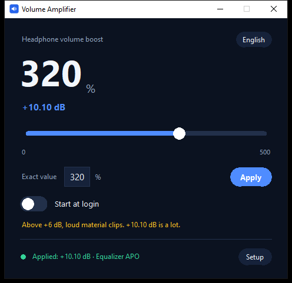

# Volume Booster PC

> ## ⚠️ Loud audio can hurt you, and it can break your equipment
>
> This app raises your system volume far beyond what Windows allows: up to
> **1000 % (+20 dB)**. At that level you can damage your **hearing**, and you can
> damage **speakers, headphones or amplifiers** that were never meant to take it.
>
> You decide how much gain to apply. The author is **not liable** for hearing
> damage, damaged equipment, or any other harm caused by using this software or by
> playing audio too loud. The app warns you as you go up; the rest is your call.
>
> Free, open source, provided **as is**, without warranty of any kind — see
> [LICENSE](LICENSE) and [DISCLAIMER.txt](DISCLAIMER.txt).

> ## 🤝 Free to use — please keep it that way
>
> **Please do not sell it, and please do not build a paid product around it.**
> If you use it in a project, a video, a school or a tool of your own, **a credit
> to LeGaliza85 is appreciated.**
>
> This is a request, not a licence term: the MIT licence permits selling and does
> not require credit, and I would rather say that plainly than pretend otherwise.
> What actually applies is [LICENSE](LICENSE).

[](https://github.com/LeGaliza85/volume-booster-pc/actions/workflows/ci.yml)

**Website and FAQ:** <https://legaliza85.github.io/volume-booster-pc/>

**A free, open-source volume booster for PC that raises Windows audio above the
100 % ceiling — up to 500 % (1000 % if you insist) — with no latency added and no
telemetry at all.**

Windows is very confident that 100 % is the loudest possible number. It is wrong.
Volume Booster PC writes one line into Equalizer APO and proves, by reading the
audio engine, that the boost is actually being applied instead of quietly doing
nothing.



---

## Why this exists (and why it costs nothing)

There are plenty of "volume booster" apps out there. A surprising number of them
want money, an account, a subscription, or all three — for writing a single line
into a text file.

This one is **free for everyone, forever**. Not "free tier". Not "free with a Pro
badge". Not "free until it is popular enough". Free: MIT licence, source included,
no paywall, no telemetry, no ads, no nag screen, no account.

I built it because paying for a volume slider is a strange thing to have to do.
If a page ever asks you for money to download this, you are on the wrong page.

**Cost of running it:** 0 €. **Cost of building it:** 0 €. **Cost of hearing your
music at the volume you want:** also 0 €.

---

## What it actually does

- **Boosts the whole output endpoint, not just headphones.** The gain is applied
  before any `Device:` block, so speakers, headphones and virtual outputs all get
  the same treatment.
- **0 % to 500 %** with a continuous slider, plus an exact-number box for people
  who know what they want. The ceiling is yours: **Settings → Limits** raises it to
  1000 % if you really want +20 dB.
- **Listen before you commit.** A **Test** button plays a short tone through the
  current chain, and moving the slider plays a tone at the level you are pointing
  to — so you hear the difference instead of guessing. The preview can be turned
  off in Settings.
- **Verifies that the boost is real.** It reads the COM classes Windows registers
  for each audio endpoint, so `Applied` never means "I wrote a file and hoped".
- **Zero added latency.** It does not capture, buffer or replay audio — Equalizer
  APO applies the gain in the existing path.
- **Nine languages**, chosen automatically from your system language.
- **Lives next to the clock.** One small window and a tray icon; no background
  service, no driver, nothing running that you did not ask for.
- **Tells you about new releases when you ask.** A *Check for updates* link, plus
  an optional check at startup that is off by default.

### What it deliberately does not do

- It does not "enhance" your audio with bass, 3D effects or magic.
- It does not record, upload or inspect what you listen to.
- It does not install a driver, a kernel extension or a service.

---

## Install on Windows

Pick whichever you prefer — both are the same program.

| Download | Best for |
|---|---|
| **`VolumeBoosterSetup.exe`** | Most people. Per-user install, no administrator prompt, Start-menu entry and a clean uninstaller |
| **`VolumeBooster.exe`** | Portable: one file, nothing installed, run it from anywhere |

1. Download one of them from [Releases](../../releases).
2. Equalizer APO is required for anything above 100 % (see below). Install it
   once:
   1. Get it from <https://sourceforge.net/projects/equalizerapo/>.
   2. **Tick only the playback device you want to boost.** Ticking everything is
      how you end up boosting the wrong thing.
   3. Reboot.
   4. Sound settings → your device → **Enhancements**: leave *Disable all
      enhancements* **unticked**.
3. Run Volume Booster, move the slider, press **Apply**.

### "Windows protected your PC"

The executable is **not code-signed**, because a signing certificate costs around
200 €/year and this project has a budget of exactly zero. SmartScreen shows that
warning for any new unsigned binary — it is a reputation warning, not a virus
detection.

Continue with **More info → Run anyway**, or verify the download instead:

```powershell
# Compare against SHA256SUMS.txt from the same release
Get-FileHash .\VolumeBooster.exe -Algorithm SHA256

# Or build it yourself (Python 3.11+)
powershell -ExecutionPolicy Bypass -File build.ps1
```

---

## Status states

The status bar is the app being honest with you.

| State | Meaning | What to do |
|---|---|---|
| `Applied: … · Equalizer APO` | Gain written and the APO is attached to at least one endpoint | Nothing |
| `Equalizer APO is not attached to any device` | Installed, but no endpoint uses it | Re-run the installer and tick your device |
| `The config was changed outside the app` | Something else edited the gain file | Press **Apply** |
| `Boost engine not found` | Equalizer APO is missing | Press **Setup** |

---

## Notification area and hotkeys

Volume Booster lives in the notification area, next to the clock — it does not take
a slot in the taskbar.

- **Left-click the icon** to open the window. **Right-click** for Open, Settings,
  Report a bug and Quit. If Explorer restarts, the icon comes back on its own.
- **Closing the window hides it**, it does not quit. The boost stays applied either
  way: Equalizer APO keeps it, so nothing is lost while the app is closed.
- **Global hotkeys**: `Ctrl+Alt+Up` and `Ctrl+Alt+Down` by default, ten percent per
  press. Change them — or clear them — from **Settings → Global hotkeys**. The
  tooltip shows the current level, and a notification pops up when you change it
  while the window is hidden.
- The very first run shows the window once, so you know where it went. After that
  it starts hidden.

Everything above is configurable in **Settings**, including whether it starts in
the notification area at all.

## Settings window

Click **Setup** and you get a real settings window, not a message box:

- **Windows setup** — only what actually needs attention. With Equalizer APO
  missing you get one red row and a **Download** button; once it is installed that
  row disappears. With the APO attached, the row offers **Change** to open the
  Configurator and pick other devices. If Windows has *Disable all enhancements*
  ticked on that device, a red row says so and names it — Windows stores that flag
  per endpoint, so the row disappears on its own once you untick it. The button
  opens the Sound panel and the row carries the click path, because Windows has no
  way to open one device's properties page directly. The reboot hint only appears
  while the APO is not attached yet.
- **Global hotkeys** — click a shortcut and press the combination you want; Esc
  cancels.
- **Sound** — the slider preview tone and the loud-level warning.
- **Limits** — the slider ceiling, 100 % to **1000 %**. This is how you go past
  500 %: type the number and press Enter, and the slider stops at the new ceiling.
- **Updates** — a **Check for updates** link at the bottom of the main window, an
  optional check at startup, and an optional **download and install automatically**
  switch. Both are off by default; see below for what the updater does.
- **Startup** — start in the notification area, and close to it.

If you push the slider into a very loud level, the app asks first. That warning
has a **Don't ask again** switch, and you can turn it back on from
**Settings → Sound**.

### What the updater does, exactly

Both update switches are **off by default**. When you turn them on:

1. The app asks GitHub for the latest release tag. That is the whole request; it
   sends nothing about you, not even your version.
2. If there is a newer version, it downloads `VolumeBoosterSetup.exe` **and**
   `SHA256SUMS-windows.txt` from that same release, and refuses to run anything
   whose SHA-256 does not match.
3. It hands the verified installer to Windows, waits while it installs silently,
   and starts the app again.

Three rails worth knowing:

- Automatic installation only happens for an **installed** copy. The portable
  `.exe` is a single loose file and is never replaced behind your back — it just
  tells you an update exists.
- A version that failed to install once is **not retried in a loop**; the app tells
  you instead.
- Downloading with the app (rather than a browser) means the file carries no
  Mark-of-the-Web, so SmartScreen does not get a say. That is normal for an
  updater, and it is also why step 2 exists: the hash is the check.

`%APPDATA%\VolumeBooster\settings.json` can also be edited by hand:

| Key | Default | Range | Meaning |
|---|---|---|---|
| `max_percent` | `500` | 100–1000 | Slider ceiling |
| `confirm_above` | `300` | 0–1000 | Ask before jumping above this level; `0` disables the question |
| `restore_on_exit` | `false` | bool | Set the gain back to 100 % when the app closes |
| `start_hidden` | `true` | bool | Start in the notification area |
| `close_to_tray` | `true` | bool | Closing the window hides it instead of quitting |
| `hotkey_up` | `Ctrl+Alt+Up` | hotkey | Louder by 10 %; empty string disables it |
| `hotkey_down` | `Ctrl+Alt+Down` | hotkey | Quieter by 10 %; empty string disables it |
| `preview_sound` | `true` | bool | Play a tone while moving the slider |
| `check_updates` | `false` | bool | Check GitHub for a new release at startup |
| `auto_update` | `false` | bool | Download and install an update when one is found |
| `update_attempted` | (empty) | version | Set by the app so a failed update is not retried in a loop |

Invalid values are ignored and clamped. A corrupted file never crashes the app —
it just falls back to the defaults.

---

## Languages

English, Español, Français, Deutsch, Italiano, Português (BR), Русский,
简体中文, 日本語. The app starts in your system language and remembers what you
pick.

---

## Which devices get boosted?

All of them, by design: the gain sits before any `Device:` block, so every
endpoint Equalizer APO is attached to gets the same level.

If you want the boost on your headphones but not on your speakers, the right
place is Equalizer APO's own device selection — that is exactly what its
Configurator does, and the app takes you there with one click from
**Settings → Attached to a playback device**.

Per-device *gain* profiles are deliberately not implemented. Equalizer APO
matches a `Device:` rule against the device name, the connection name and the
GUID, and a rule that does not match is applied silently — no boost, no error.
Shipping that would turn this app's "the boost is verified" promise into a guess,
which is the one thing it is not allowed to be.

---

## Privacy and safety

- **No telemetry, no analytics.** The only network call is the update check: it
  runs when you press **Check for updates**, or at startup if you turn that on in
  Settings. It asks GitHub for the latest release tag and sends nothing about you —
  not even which version you have.
- **Audio never leaves the machine.** The app writes one number into one text
  file. That is the whole pipeline.
- **The rest of your config is untouched.** It owns one include file
  (`volume-booster.txt`) and adds a single `Include:` line; every other line in
  your Equalizer APO config stays byte-for-byte identical.
- **Two gains can never stack.** Two `Preamp` filters in the same chain *add up*,
  so the app removes the block written by the previous app and keeps exactly one
  gain source.
- **Writes are atomic** (temp file + replace) and preserve BOM, encoding and line
  endings. The original config is backed up once before the first change.
- **Fail closed.** A config with unbalanced markers is refused, never guessed at.
- **`--diagnostics`** writes a support bundle with your user name and home path
  replaced by `<user>` / `<home>`. It also carries `crash.log`, which only
  has content if the process died on a native call.

---

## Command line

```
VolumeBooster.exe                 # the UI
VolumeBooster.exe --version
VolumeBooster.exe --health        # verification state as JSON
VolumeBooster.exe --settings      # effective settings and their path
VolumeBooster.exe --diagnostics   # scrubbed support bundle
VolumeBooster.exe --report        # the pre-filled bug report URL
VolumeBooster.exe --minimized     # start hidden in the notification area
```

---

## How the boost works

Windows clamps every audio endpoint at 100 %. No amount of API calls changes
that, and a volume booster that only moves the Windows slider is lying to you.

The only way past the ceiling without adding latency is a signed Audio Processing
Object in the path. Equalizer APO registers one for each enabled endpoint, and it
applies digital gain with no buffering — so the audio path stays exactly as long
as it was. Capture-and-replay boosters are the other approach, and they add 20–50
ms, which is why this one does not do that.

The verification step reads the COM class IDs that Windows stores per endpoint
under `…\MMDevices\Audio\Render\{guid}\FxProperties`. If the APO is there, the
boost runs. If it is not, you get told instead of wondering.

---

## Build from source

```powershell
python -m pip install pyinstaller
powershell -ExecutionPolicy Bypass -File build.ps1
```

`build.ps1` regenerates the icon, builds the executable, creates the portable zip
and writes `dist\SHA256SUMS.txt`. On Linux, `./build.sh`.

## Tests

```
python -m unittest test_configfile test_apo test_i18n test_platform test_settings test_diagnostics test_verify test_report test_hotkey test_winenv test_preview test_update test_update_download test_updater
python app.py --smoke
python app.py --smoke-ui
```

`test_apo` and the smoke tests exercise Equalizer APO, so they run on Windows and
skip elsewhere.

---

## Platform support

| OS | Status | Engine |
|---|---|---|
| Windows 10/11 | Full | Equalizer APO |
| Linux (PipeWire/PulseAudio) | Full | `pactl set-sink-volume` |
| macOS | Not supported | Would need a virtual audio device, which adds latency |

---

## En español

> ## ⚠️ El audio muy alto puede dañar tu oído y tus altavoces
>
> Esta aplicación sube el volumen del sistema mucho más allá de lo que permite
> Windows: hasta el **1000 % (+20 dB)**. A ese nivel puedes dañar tu **oído**, y
> también **altavoces, auriculares o amplificadores** que no estén preparados.
>
> Tú decides cuánta ganancia aplicar. El autor **no se hace responsable** de los
> daños auditivos, de los equipos dañados ni de ningún otro perjuicio derivado de
> usar este programa o de reproducir audio demasiado alto. La app te avisa según
> subes; el resto es decisión tuya.
>
> Gratis, código abierto y se ofrece **tal cual**, sin garantía de ningún tipo —
> ver [LICENSE](LICENSE) y [DISCLAIMER.txt](DISCLAIMER.txt).

> ## 🤝 Gratis para usar — por favor, que siga siéndolo
>
> **Por favor, no lo vendas ni montes un producto de pago con él.** Si lo usas en
> un proyecto, un vídeo, un centro educativo o una herramienta tuya, **se agradece
> el crédito a LeGaliza85.**
>
> Esto es una petición, no una condición de la licencia: la MIT permite venderlo y
> no exige crédito, y prefiero decirlo claro a fingir lo contrario. Lo que se
> aplica de verdad es [LICENSE](LICENSE).

**Volume Booster PC** sube el volumen del sistema **por encima del 100 %**, hasta
el 500 % (1000 % si te empeñas), sin añadir latencia y sin telemetría.

- Sirve para **todo el audio del equipo**, no solo para auriculares.
- **Gratis para siempre**, con el código a la vista y licencia MIT. Sin cuenta, sin
  publicidad, sin versión "Pro". Si alguien te pide dinero por esto, no es esta
  página.
- En Windows necesita [Equalizer APO](https://sourceforge.net/projects/equalizerapo/)
  instalado una vez: Windows no deja pasar del 100 % de otra forma.
- En Linux usa `pactl` y no necesita nada más.

Si lo que buscabas era **subir el volumen en Windows 11 por encima del 100 %**, o
una **aplicación para subir el volumen al 200 %** en el PC, esto es exactamente
eso: un *volume booster* de escritorio, gratuito y de código abierto.

---

## Found a bug?

There is a **Report a bug** link at the bottom of the window. It opens a GitHub
issue with the version and your operating system already filled in, so you only
have to describe what happened.

If you prefer to do it by hand, use
[Issues](../../issues/new?template=bug_report.yml). Attaching the support bundle
from `--diagnostics` makes a fix much faster: run it, then drag the zip into the
form. The bundle contains no audio, and your user name and home path are replaced
by `<user>` / `<home>`.

Things that help more than anything else:

- The status bar text (`Applied`, `drift`, `not attached`, `engine not found`).
- Whether Equalizer APO is installed, and whether your device is ticked in it.
- The exact slider value that misbehaves.

---

## Credits

Made by **LeGaliza85** — <https://github.com/LeGaliza85>

## License

MIT — see [LICENSE](LICENSE). Copyright (c) 2026 LeGaliza85.
